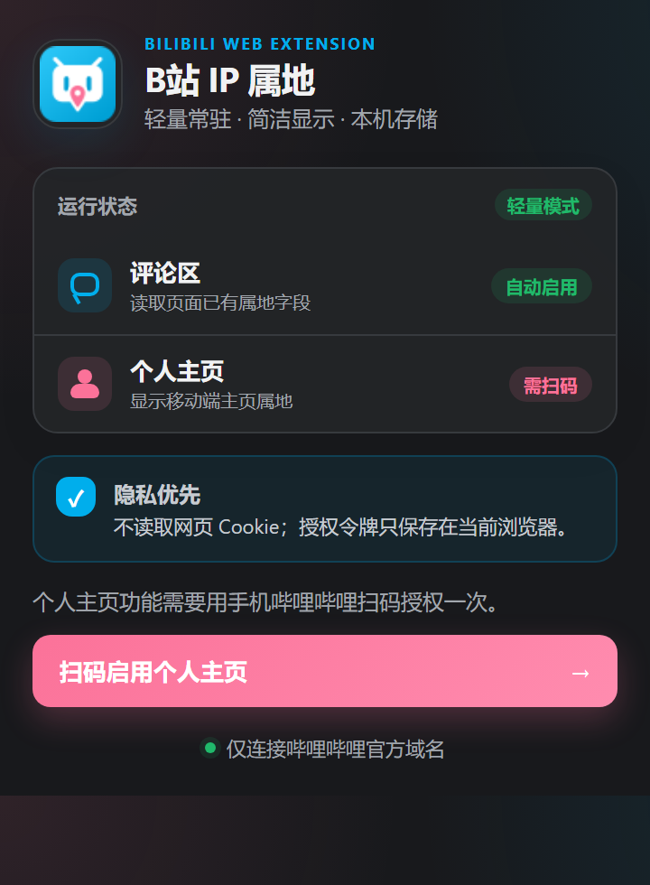

  
  <h1>B站 IP 属地</h1>
  
让哔哩哔哩网页端像移动端一样，在评论区与个人主页显示 IP 属地。

  
<code>Chrome / Edge</code>　<code>Manifest V3</code>　<code>无框架</code>　<code>MIT</code>

  

## 功能

| 场景 | 使用方式 | 数据来源 |
| --- | --- | --- |
| 评论区 | 安装后自动启用，无需扫码 | B 站网页已经取得的评论属地字段 |
| 个人主页 | 首次使用手机哔哩哔哩扫码一次 | B 站移动端个人空间接口 |

扩展只显示 B 站返回的归属地文本，不查询真实 IP，也不会推断更精确的位置。字段不存在时会静默跳过，不伪造结果。

## 安装

### 从 Release 安装

1. 在仓库右侧打开 **Releases**，下载最新的 `bilibili-ip-location-v*.zip`。
2. 解压 ZIP 文件。
3. 打开 `chrome://extensions/`；Edge 用户打开 `edge://extensions/`。
4. 开启右上角的“开发者模式”。
5. 点击“加载已解压的扩展程序”，选择解压后的文件夹。
6. 建议把扩展固定到浏览器工具栏，然后刷新已经打开的 B 站页面。

也可以直接下载仓库源码并按相同步骤加载项目根目录。

## 使用

### 评论区

无需设置。打开视频、动态、专栏等带有新版 B 站评论组件的页面，属地会显示在评论时间附近。

旧于 B 站 IP 属地功能上线时间的评论，或者 B 站没有向当前网页会话返回属地字段时，不会显示。

### 个人主页

1. 点击浏览器工具栏中的“B站 IP 属地”图标。
2. 点击“扫码启用个人主页”。
3. 使用手机哔哩哔哩“扫一扫”，并在手机端确认。
4. 刷新 `https://space.bilibili.com/用户UID` 页面。

授权失效时重新扫码即可。点击弹窗中的“清除本机授权”可以随时删除本地令牌。

## 隐私与安全

- 不读取网页 Cookie，不申请 `cookies`、`tabs`、`webRequest` 或 `<all_urls>` 权限。
- 不包含统计、广告、遥测或第三方服务器。
- 扫码得到的 `access_token` 只写入当前浏览器的 `chrome.storage.local`。
- 令牌不会进入源码、Git 提交、控制台日志或浏览器同步。
- 网络请求只发送到哔哩哔哩官方域名。
- 源码中的 B 站客户端签名常量来自公开客户端兼容实现，不是任何用户的账号密钥。

### 权限说明

| 权限或站点 | 用途 |
| --- | --- |
| `storage` | 只在本机保存个人主页扫码授权令牌 |
| `declarativeNetRequestWithHostAccess` | 只为扩展自身的两个扫码请求移除来源头，不读取或改写网页请求 |
| `https://*.bilibili.com/*` | 从 B 站页面已有数据中读取评论属地并渲染 |
| `https://passport.bilibili.com/*` | 用户主动扫码时生成并轮询 B 站官方授权 |
| `https://app.bilibili.com/*` | 授权后读取 B 站移动端个人空间属地 |

扫码接口可能拒绝携带扩展来源头的请求。本扩展使用一条会话级声明式规则，只对由扩展自身发起、发往两个精确扫码接口的 POST 请求移除 `Origin` 与 `Referer`。规则不会作用于网页请求，浏览器退出后自动清除。

## 为什么轻量

- 原生 JavaScript、HTML 与 CSS，无框架、无打包器。
- Manifest V3 Service Worker 只在扫码或查询个人主页时短暂唤醒。
- 评论区优先挂钩 B 站评论组件更新周期，不轮询评论接口。
- 二维码生成器只在打开扩展弹窗时加载。

## 已知限制

- B 站网页结构和未公开接口变化后，扩展可能需要更新。
- 个人主页功能依赖一次移动端扫码授权，无法安全地由网页 Cookie 替代。
- 如果 B 站已经原生显示属地，扩展会避免重复插入。
- 本项目是非官方社区扩展，与哔哩哔哩没有隶属或合作关系。

## 开源许可

评论区兼容策略参考了 MIT 许可的 BiliReveal 与 BiliScope；扫码授权流程参考了 MIT 许可的 BewlyBewly。二维码生成使用 `qrcode-generator`，MD5 实现来自 MIT 许可的 blueimp JavaScript-MD5。

完整声明见 [THIRD_PARTY_NOTICES.md](./THIRD_PARTY_NOTICES.md)。本项目使用 [MIT License](./LICENSE)。
